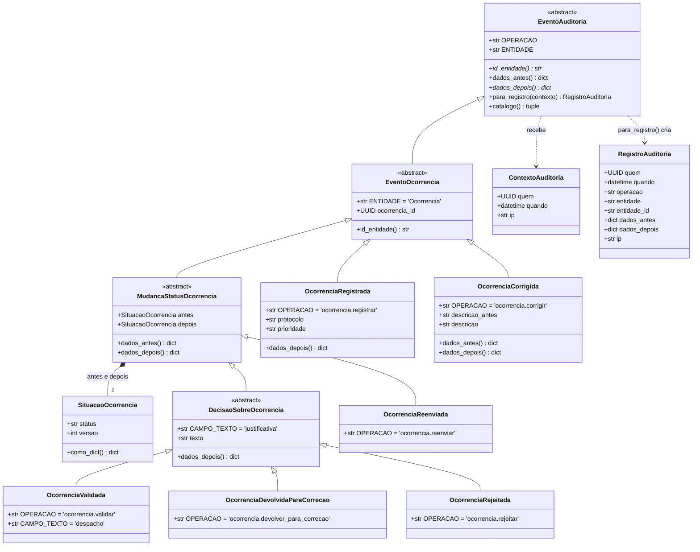
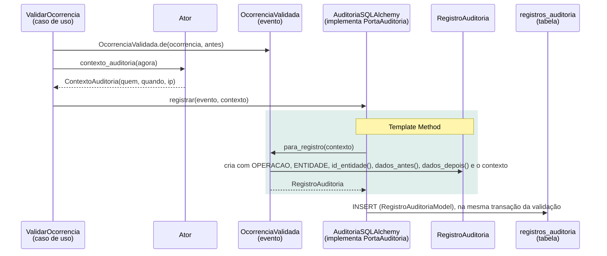

# Auditoria — eventos tipados (RNF03)

Diagramas da auditoria por eventos. Código em `backend/src/domain/auditoria/` (classe base) e nos `auditoria.py` de cada agregado (subclasses). O GitHub desenha os blocos `mermaid` abaixo direto na página.

## 1. Diagrama de classes — eventos da ocorrência

Cada nível da hierarquia preenche uma parte do registro. A ação concreta (ex.: `OcorrenciaValidada`) declara só a `OPERACAO` e herda o resto. O `RegistroAuditoria` **não faz parte da herança**: ele é criado pelo `para_registro()` da classe base.

Como ler:

- **Setas com triângulo vazado** indicam herança, sempre da filha para a mãe.
- **Seta tracejada** indica que uma classe usa ou cria a outra, sem herdar dela.
- `<<abstract>>` marca as classes que não podem ser instanciadas: a base e as intermediárias, que não têm `OPERACAO`.
- Métodos com `*` são abstratos e cada subclasse precisa implementá-los.

### De onde vem cada campo do registro de `OcorrenciaValidada`

| Campo do `RegistroAuditoria` | Quem fornece |
| :--- | :--- |
| `operacao` | `OcorrenciaValidada.OPERACAO` → `"ocorrencia.validar"` |
| `entidade` | `EventoOcorrencia.ENTIDADE` → `"Ocorrencia"` |
| `entidade_id` | `EventoOcorrencia.id_entidade()` → id da ocorrência |
| `dados_antes` | `MudancaStatusOcorrencia.dados_antes()` → `status` e `versao` antes |
| `dados_depois` | `DecisaoSobreOcorrencia.dados_depois()` → `status` e `versao` depois + `despacho` (nome vindo do `CAMPO_TEXTO` da `OcorrenciaValidada`) |
| `quem`, `quando`, `ip` | `ContextoAuditoria`, montado por `ator.contexto_auditoria(agora)` |

## 2. Diagrama de sequência — gravação

O caso de uso conhece só a porta (`PortaAuditoria`). Quem sabe montar a linha é o evento, e quem sabe gravar no banco é o adapter. Como a gravação acontece na mesma transação da validação, ou entram as duas coisas (ocorrência validada e auditoria), ou nenhuma.
